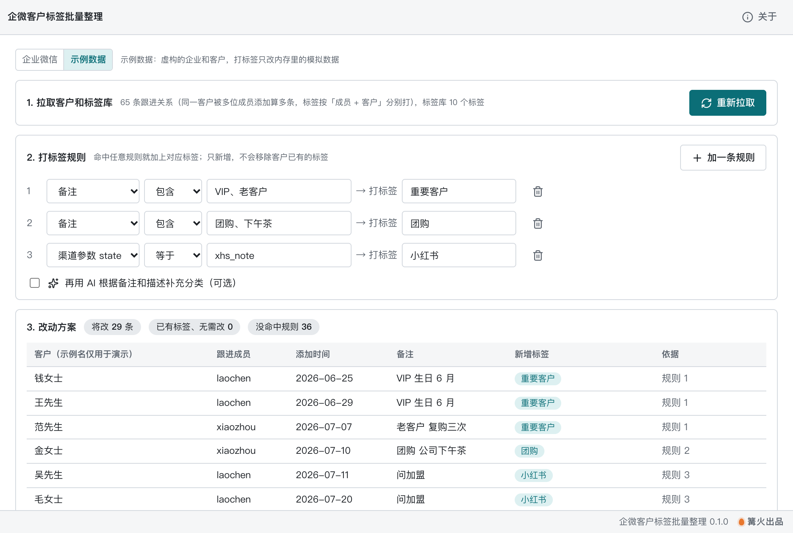

# 企微客户标签批量整理

> 篝火出品 · 收录于篝火 App 应用区

官方接口拉客户，按规则或 AI 批量打标签



## 下载

到 [Releases](https://github.com/campfire-code/wecom-customer-tagger/releases/latest) 下载对应安装包：

| 电脑 | 文件 |
|---|---|
| Windows 10 / 11 | `wecom-customer-tagger_版本号_windows-x64-setup.exe` |
| Mac（Apple 芯片） | `wecom-customer-tagger_版本号_mac-arm64.dmg` |
| Mac（Intel 芯片） | `wecom-customer-tagger_版本号_mac-x64.dmg` |

第一次打开：
- **Windows**：如果弹出「Windows 已保护你的电脑」，点「更多信息」→「仍要运行」。
- **Mac**：如果提示「无法验证开发者」，打开「系统设置 → 隐私与安全性」，在下方点「仍要打开」。

## 怎么用

先决条件：你要有企业微信的管理员权限，并在管理后台完成下面几步（接口要求，核对自企业微信开发者中心文档）：

1. 在「我的企业 → 企业信息」底部复制**企业 ID**。
2. 在「应用管理」里创建（或使用已有的）**自建应用**，复制它的 **Secret**。
3. 在「客户联系 → 客户 → 可调用接口的应用」里把这个自建应用加进去，否则会提示没有权限（错误码 48002 / 84074）。
4. 自建应用的**可见范围**要包含需要处理的成员，成员需要开通客户联系功能。
5. 在应用详情的「企业可信IP」里填本机所在网络的公网出口 IP（固定 IP），否则会报错误码 60020。动态 IP 变化后需要重新填写。
6. 2023 年 12 月 1 日起，新企业不能再用系统应用的 Secret 调用客户联系接口，请使用自建应用。

操作：

1. 打开工具，在「企业微信设置」里填企业 ID 和 Secret，点「保存并测试连接」。二者只保存在本机设置里，不会上传，也不会写进日志。没有企业账号可以先切到「示例数据」体验全部流程。
2. 点「拉取客户」：先取配置了客户联系的成员，再按每 100 位成员一组批量取客户和跟进信息，同时读取企业标签库。
3. 写「打标签规则」：按备注、描述、客户企业名、渠道参数 state、跟进成员、添加方式、客户类型、添加天数设置条件，命中就打上指定标签。标签库里没有的标签会在你填的标签组下新建（标签名、标签组名最长 30 个字符）。
4. 可选：勾选「AI 补充分类」，选出允许 AI 使用的标签，点「让 AI 分类」。大模型接口、密钥、模型名在本工具的「设置」页自己填（兼容 OpenAI 接口格式）。只会发送客户的备注、描述、客户企业名、渠道参数，不发客户昵称和 ID，AI 只能从你勾选的标签里选。本工具不读取聊天记录。
5. 在「改动方案」里核对每一条，点「执行打标签」并确认。只新增标签，不会移除客户已有的标签；已经带有该标签的客户会被跳过，所以可以重复执行。
6. 执行后可「导出结果表」（CSV），每一行有成功或失败及原因。

提示：标签是按「成员 + 客户」分别打的（同一客户被多位成员添加时会有多条）；撤销需要在企业微信里手动去掉标签。

**未核实**：mark_tag 接口的单独调用频率上限官方页面没有写明；本工具每条间隔约 0.12 秒，遇到频率限制（45009 / 45033）会等 60 秒重试一次。错误码 60020 报错文字里是否带来源 IP，未用真实账号核对，取不到就不显示。

## 验收用例

以下全部用「示例数据」完成，不需要企业微信账号，也不联网：

1. 打开工具，确认顶部选中「示例数据」，点「拉取客户」。应显示 4 位成员、65 条客户关系、10 个企业标签。
2. 规则 1 填：备注 包含 `VIP、老客户` → 标签 `重要客户`。「改动方案」应出现若干条，新增标签列显示「重要客户」，依据列显示「规则 1」。
3. 再加规则：备注 包含 `团购` → 标签 `企业团购`（标签库里没有）。方案顶部应出现「需先新建标签 自动标签/企业团购」。
4. 点「执行打标签」→「确认执行」。应提示「完成：成功 N 条，失败 0 条」，N 等于方案条数，每行结果为「成功」。
5. 点「重新拉取」。上一步打过标签的客户应不再出现在方案里，「已有标签、无需改」数量大于 0（证明可重复执行、不会重复打）。
6. 点「导出结果表」，得到 CSV，用表格软件打开应有 6 列：跟进成员、客户 external_userid、客户名称、新增标签、结果、失败原因。
7. 真实企业验收：按「怎么用」完成后台设置，切到「企业微信」，在「企业微信设置」点「保存并测试连接」，应提示「连接成功：能读取 N 位开通了客户联系的成员」。Secret 故意填错应提示「Secret 不对」；没配可信 IP 应提示配置「企业可信IP」。

## 自己编译

需要 Node.js 22、pnpm、Rust。

```bash
pnpm install
pnpm test          # 单元测试
pnpm tauri dev     # 开发运行
pnpm tauri build   # 打包
```

界面框架在 `src/kit`（所有 campfire-code 工具共用），本工具的逻辑在 `src/tool`。

## 归属

本工具由**篝火**出品，是篝火 App 应用区收录的开源工具之一，由篝火（GitHub 组织 [campfire-code](https://github.com/campfire-code)）维护与更新。全部工具的目录见 [toolkit-hub](https://github.com/campfire-code/toolkit-hub)。

## 许可证

MIT，版权方为篝火（campfire-code）。
